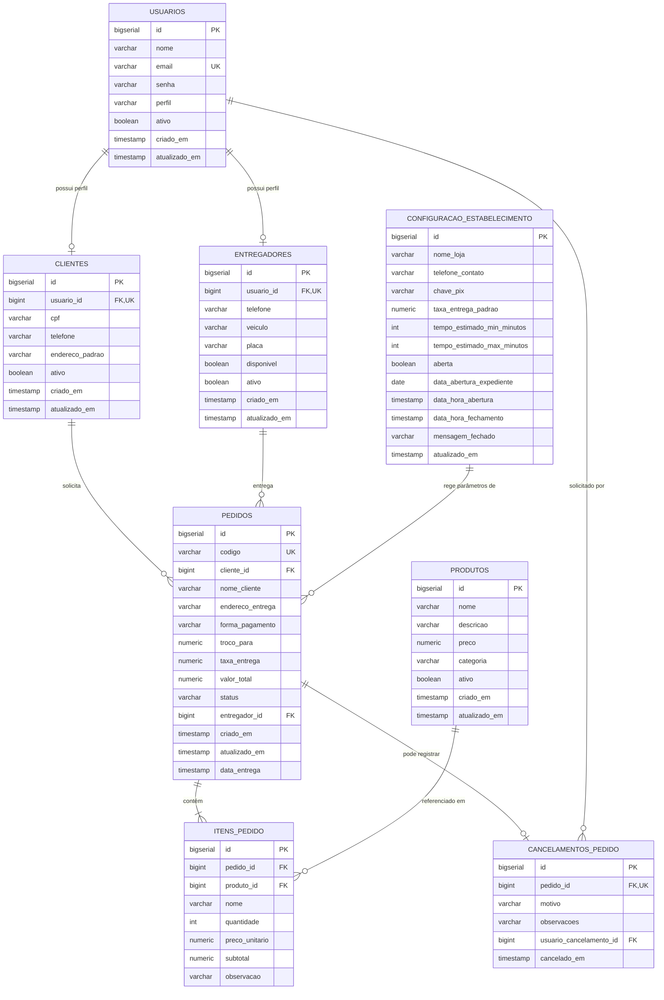

# 🍔 Pede Rango API — Documentação Técnica Completa

Bem-vindo à documentação técnica oficial da **Pede Rango API**, uma solução moderna de backend para gerenciamento de pedidos, cardápio, controle de expediente e turno diário, logística de entregas, BI executivo e controle de acesso baseado em papéis (RBAC) em tempo real.

---

## 📌 Sumário
1. [Visão Geral e Arquitetura](#-1-visão-geral-e-arquitetura)
2. [Stack Tecnológica](#-2-stack-tecnológica)
3. [Modelo de Dados (Diagrama & Tabelas)](#-3-modelo-de-dados)
4. [Fluxo de Autenticação e Perfis (RBAC)](#-4-fluxo-de-autenticação-e-perfis-rbac)
5. [Catálogo de Endpoints (REST API)](#-5-catálogo-de-endpoints-rest-api)
   - [5.1. Autenticação](#51-autenticação-auth)
   - [5.2. Configurações Operacionais & Expediente](#52-configurações-operacionais--expediente-apiconfiguracoes)
   - [5.3. Pedidos](#53-pedidos-apipedidos)
   - [5.4. Cardápio / Produtos](#54-cardápio--produtos-apiprodutos)
   - [5.5. Clientes](#55-clientes-apiclientes)
   - [5.6. Entregadores](#56-entregadores-apientregadores)
   - [5.7. Gestão de Usuários](#57-gestão-de-usuários-apiusuarios)
   - [5.8. Relatórios Executivos & BI](#58-relatórios-executivos--bi-apirelatorios)
6. [Regras de Negócio e Ciclo de Vida do Pedido](#-6-regras-de-negócio-e-ciclo-de-vida-do-pedido)
7. [Infraestrutura e Deploy (Docker & Kubernetes/Helm)](#-7-infraestrutura-e-deploy-docker--kuberneteshelm)
8. [Configurações e Variáveis de Ambiente](#-8-configurações-e-variáveis-de-ambiente)
9. [Guia de Inicialização e Primeiro Acesso](#-9-guia-de-inicialização-e-primeiro-acesso)

---

## 🏛️ 1. Visão Geral e Arquitetura

A API adota o estilo arquitetural **RESTful**, organizada em camadas bem delimitadas:

```
[ Cliente Web / PWA / Mobile ]
              │ (HTTP/JSON + JWT)
              ▼
    [ NGINX Ingress / Gateway ]
              │
              ▼
      [ Spring Boot API ]
      ├── Security (JWT + CORS Filter + RBAC)
      ├── Controllers (Endpoints REST)
      ├── Services (Regras de Negócio, Operações & Validações)
      ├── Repositories (Spring Data JPA)
      └── Domain & DTOs
              │
              ▼
   [ PostgreSQL 16 (pede_rango_db) ]
```

---

## 🛠️ 2. Stack Tecnológica

| Componente | Tecnologia | Versão | Função Principal |
| :--- | :--- | :--- | :--- |
| **Linguagem** | Java | 21 (LTS) | Linguagem base moderna com records e pattern matching |
| **Framework** | Spring Boot | 3.3.x | Ecossistema da aplicação |
| **Segurança** | Spring Security + Auth0 Java JWT | 3.3.x / 4.4.x | Autenticação Stateless via Bearer Token HMAC256 |
| **Persistência** | Spring Data JPA / Hibernate | 3.3.x | Mapeamento Objeto-Relacional (ORM) |
| **Banco de Dados** | PostgreSQL | 16-alpine | Banco relacional ACID para persistência transacional |
| **Documentação** | Springdoc OpenAPI (Swagger UI) | 2.5.x | Interface interativa de endpoints |
| **Containers** | Docker / Docker Compose | 24+ | Empacotamento em contêineres multi-stage |
| **Orquestração** | Kubernetes (Kind) + Helm 3 | 1.36+ / v3 | Gerenciamento declarativo, Auto-scaling (HPA) e Ingress |

---

## 🗄️ 3. Modelo de Dados

### 3.1. Entidades Principais



---

## 🔐 4. Fluxo de Autenticação e Perfis (RBAC)

A API utiliza tokens **JWT (JSON Web Token)** assinados com algoritmo HMAC256.

### 4.1. Perfis de Acesso (`PerfilUsuario`)
- **`ADMIN`**: Perfil executivo e administrativo. Visualiza relatórios avançados de BI (diário, semanal, quinzenal e mensal), exportação de CSV, gestão de usuários de todos os perfis, controle de parâmetros da loja e cancelamentos. *(Não cria pedidos diretamente, focando na administração e supervisão).*
- **`RESTAURANTE`**: Operador do restaurante / frente de loja. Gerencia a abertura e encerramento de turno de trabalho, controle operacional do cardápio, acompanhamento de pedidos em tempo real e parâmetros comerciais da loja.
- **`CLIENTE`**: Visualização do cardápio oficial, cálculo automático de taxa e tempo estimado, montagem e envio de pedidos, pagamento na entrega (Dinheiro/Troco, PIX com chave da loja, Cartão), repetição de pedidos anteriores com 1 clique e cancelamento de pedidos não finalizados.
- **`ENTREGADOR`**: Fila de entregas em tempo real, aceite de pedidos prontos para entrega, contato rápido via WhatsApp com clientes e alteração de status (`SAIU_PARA_ENTREGA` / `ENTREGUE`).

### 4.2. Header de Requisição
Para endpoints protegidos, inclua no cabeçalho HTTP:
```http
Authorization: Bearer <SEU_TOKEN_JWT_AQUI>
```

---

## 📡 5. Catálogo de Endpoints (REST API)

### 5.1. Autenticação (`/auth`)
| Método | Rota | Perfil | Descrição |
| :--- | :--- | :--- | :--- |
| `POST` | `/auth/login` | Público | Autentica com e-mail/senha e retorna o JWT + dados do usuário |
| `POST` | `/auth/registrar` | Público | Auto-cadastro de novo cliente (cria usuário + perfil de cliente) |

### 5.2. Configurações Operacionais & Expediente (`/api/configuracoes` / `/configuracoes`)
| Método | Rota | Perfil | Descrição |
| :--- | :--- | :--- | :--- |
| `GET` | `/api/configuracoes` | Público / Autenticado | Retorna os parâmetros atuais do estabelecimento (`lojaAberta`, `expedienteIniciadoHoje`, `taxaEntregaPadrao`, `tempoEstimadoMinMinutos`, `tempoEstimadoMaxMinutos`, `chavePix`, etc.) |
| `POST`| `/api/configuracoes/abrir-expediente` | `ADMIN`, `RESTAURANTE` | **Abre as operações do dia**. Registra a data do expediente (`dataAberturaExpediente`) e parâmetros do turno (taxa do dia, tempo estimado). |
| `POST`| `/api/configuracoes/fechar-expediente` | `ADMIN`, `RESTAURANTE` | **Encerra o expediente** do dia, resetando `dataAberturaExpediente` e desativando o recebimento de pedidos. |
| `PATCH`| `/api/configuracoes/alternar-status` | `ADMIN`, `RESTAURANTE` | **Pausa ou retoma** o recebimento de novos pedidos dentro do turno atual. |
| `PUT` | `/api/configuracoes` | `ADMIN`, `RESTAURANTE` | Atualiza parâmetros comerciais gerais (taxa padrão, chave PIX, telefone de contato, etc.). |

#### Estrutura do DTO de Configurações (`ConfiguracaoEstabelecimentoDTO`):
```json
{
  "nomeLoja": "Pede Rango Delivery",
  "telefoneContato": "(11) 98765-4321",
  "chavePix": "financeiro@pederango.com",
  "taxaEntregaPadrao": 5.00,
  "tempoEstimadoMinMinutos": 30,
  "tempoEstimadoMaxMinutos": 50,
  "lojaAberta": true,
  "expedienteIniciadoHoje": true,
  "dataAberturaExpediente": "2026-09-06",
  "mensagemFechado": "Estamos fechados no momento. Volte no próximo expediente!"
}
```

### 5.3. Pedidos (`/api/pedidos`)
| Método | Rota | Perfil | Descrição |
| :--- | :--- | :--- | :--- |
| `GET` | `/api/pedidos` | Autenticado | Lista pedidos com paginação (`page`, `size`, `sort`) e filtros |
| `GET` | `/api/pedidos/{id}` | Autenticado | Detalha um pedido, itens, taxa de entrega, forma de pagamento, troco e dados de contato |
| `POST` | `/api/pedidos` | `CLIENTE`, `RESTAURANTE` | Cria novo pedido. **Valida se a loja está operacionalmente aberta hoje**, aplica taxa de entrega padrão e calcula o valor total (`subtotal + taxa`). |
| `PUT` | `/api/pedidos/{id}/status` | `ENTREGADOR`, `ADMIN`, `RESTAURANTE` | Atualiza o status do pedido no fluxo de preparação e entrega |
| `POST` | `/api/pedidos/{id}/cancelar` | Autenticado | Cancela o pedido registrando motivo e observações |
| `GET` | `/api/pedidos/estatisticas` | Autenticado | Retorna contagem agregada de pedidos por status |
| `GET` | `/api/pedidos/cancelamentos` | `ADMIN`, `RESTAURANTE` | Consulta histórico completo de pedidos cancelados |

### 5.4. Cardápio / Produtos (`/api/produtos`)
| Método | Rota | Perfil | Descrição |
| :--- | :--- | :--- | :--- |
| `GET` | `/api/produtos` | Autenticado / Público | Lista produtos ativos com paginação e filtro por categoria |
| `GET` | `/api/produtos/{id}` | Autenticado | Busca produto por ID |
| `POST` | `/api/produtos` | `ADMIN`, `RESTAURANTE` | Cadastra novo produto no cardápio |
| `PUT` | `/api/produtos/{id}` | `ADMIN`, `RESTAURANTE` | Atualiza dados/preço de um produto |
| `DELETE`| `/api/produtos/{id}` | `ADMIN`, `RESTAURANTE` | Inativa/remove produto do cardápio |

### 5.5. Clientes (`/api/clientes`)
| Método | Rota | Perfil | Descrição |
| :--- | :--- | :--- | :--- |
| `GET` | `/api/clientes` | `ADMIN`, `RESTAURANTE` | Lista clientes cadastrados com paginação e busca |
| `GET` | `/api/clientes/{id}` | Autenticado | Busca dados do perfil de cliente |
| `GET` | `/api/clientes/email/{email}` | Autenticado | Busca perfil do cliente pelo e-mail vinculado |
| `POST` | `/api/clientes` | `ADMIN` | Cadastra cliente vinculado a um usuário |
| `PUT` | `/api/clientes/{id}` | Autenticado | Atualiza telefone e endereço padrão do cliente |

### 5.6. Entregadores (`/api/entregadores`)
| Método | Rota | Perfil | Descrição |
| :--- | :--- | :--- | :--- |
| `GET` | `/api/entregadores` | Autenticado | Lista todos os entregadores e status da frota |
| `POST` | `/api/entregadores` | `ADMIN` | Cadastra novo entregador e cria conta associada |
| `PATCH`| `/api/entregadores/{id}/disponibilidade` | `ENTREGADOR`, `ADMIN` | Alterna status (online/disponível vs ocupado/offline) |
| `GET` | `/api/entregadores/{id}/pedidos` | `ENTREGADOR`, `ADMIN` | Lista pedidos atribuídos a um entregador específico |
| `PUT` | `/api/entregadores/{id}/telefone` | `ENTREGADOR`, `ADMIN` | Atualiza telefone de contato do entregador |

### 5.7. Gestão de Usuários (`/api/usuarios`)
| Método | Rota | Perfil | Descrição |
| :--- | :--- | :--- | :--- |
| `GET` | `/api/usuarios` | `ADMIN` | Lista usuários do sistema com filtro por perfil |
| `GET` | `/api/usuarios/contagem`| `ADMIN` | Retorna total de usuários agrupados por perfil |
| `POST` | `/api/usuarios` | `ADMIN` | Cria conta de usuário com qualquer perfil (`ADMIN`, `RESTAURANTE`, `ENTREGADOR`, `CLIENTE`) |

### 5.8. Relatórios Executivos & BI (`/api/relatorios` / `/relatorios`)
| Método | Rota | Perfil | Descrição |
| :--- | :--- | :--- | :--- |
| `GET` | `/api/relatorios/dashboard` | `ADMIN` | Retorna métricas consolidadas de faturamento, pedidos e ticket médio por período (`HOJE`, `SEMANA`, `QUINZENA`, `MES`) |
| `GET` | `/api/relatorios/exportar-csv` | `ADMIN` | **Exporta relatório analítico em formato CSV** (com codificação UTF-8 BOM para compatibilidade nativa com MS Excel). Parâmetros: `periodo` (`HOJE`, `SEMANA`, `QUINZENA`, `MES`) ou `inicio`/`fim` (`YYYY-MM-DD`). |

---

## 🔄 6. Regras de Negócio e Ciclo de Vida do Pedido

### 6.1. Controle de Expediente & 3 Estados Operacionais do Turno
O sistema adota um ciclo de trabalho diário explícito com 3 estados operacionais:

1. **Expediente Não Iniciado / Encerrado (`expedienteIniciadoHoje = false`)**:
   - O restaurante ainda não abriu as operações no dia ou já encerrou o turno.
   - O painel exibe o botão destacado **"Iniciar Dia de Trabalho"** com modal para confirmação de taxa de entrega e tempo estimado do dia.
   - A criação de pedidos é bloqueada pela API.

2. **Aberto & Recebendo Pedidos (`expedienteIniciadoHoje = true` e `lojaAberta = true`)**:
   - O restaurante está operacional e o cliente pode enviar pedidos normalmente.
   - O operador pode clicar em **"Pausar Recebimento"** caso a cozinha fique sobrecarregada, ou em **"Encerrar Expediente"** ao final do dia.

3. **Expediente Aberto, porém Recebimento Pausado (`expedienteIniciadoHoje = true` e `lojaAberta = false`)**:
   - O turno de trabalho do dia foi aberto, mas temporariamente pausado.
   - O painel exibe o botão **"Retomar Recebimento"** (e não "Iniciar Dia" novamente).
   - Clientes são informados que o recebimento está temporariamente pausado.

- **Virada da Meia-Noite (`00:00`)**:
  - A checagem `isOperacionalmenteAbertaHoje()` valida se `dataAberturaExpediente == LocalDate.now()`.
  - Se o operador esquecer de encerrar o expediente, à meia-noite a loja passa automaticamente para o estado fechado/não iniciado para o novo dia.

### 6.2. Taxa de Entrega, Troco e Formas de Pagamento
- Toda criação de pedido consulta a taxa de entrega vigente (`taxaEntregaPadrao`) e a fixa no registro do pedido (`pedidos.taxa_entrega`).
- `valorTotal = Subtotal dos Itens + Taxa de Entrega`.
- **Formas de Pagamento Suportadas**: `DINHEIRO`, `PIX`, `CARTAO_CREDITO`, `CARTAO_DEBITO`.
- Em pagamentos em `DINHEIRO`, se informado `trocoPara`, o valor deve ser maior ou igual a `valorTotal`. O troco a devolver (`trocoPara - valorTotal`) é exibido com destaque na comanda e nos modais de pedido.
- Em pagamentos em `PIX`, o sistema exibe a chave PIX cadastrada nas configurações com botão de cópia rápida.

### 6.3. Máquina de Estados do Pedido e Stepper Visual

```
[ RECEBIDO ] ──► [ EM_PREPARO ] ──► [ PRONTO_PARA_ENTREGA ] ──► [ SAIU_PARA_ENTREGA ] ──► [ ENTREGUE ]
      │                  │                     │                         │
      └──────────────────┴─────────────────────┴─────────────────────────┴────────► [ CANCELADO ]
```

1. **RECEBIDO**: Pedido registrado no sistema com código único (ex: `#PED-849201`).
2. **EM_PREPARO**: Cozinha iniciou a confecção dos pratos.
3. **PRONTO_PARA_ENTREGA**: Pedido embalado aguardando atribuição e saída do entregador.
4. **SAIU_PARA_ENTREGA**: Entregador em rota de entrega até o endereço do cliente.
5. **ENTREGUE**: Pedido entregue e finalizado com registro de timestamp `data_entrega`.
6. **CANCELADO**: Pedido cancelado com motivo e observações obrigatórias gravadas para auditoria.

### 6.4. Repetição de Pedidos em 1 Clique (Reorder)
- Clientes podem repetir qualquer pedido anterior finalizado diretamente pelo card ou modal de detalhe.
- O sistema carrega os itens do pedido anterior na sacola, consulta a taxa de entrega vigente e abre a etapa de confirmação de endereço e pagamento.

### 6.5. Impressão de Comanda de Cozinha (80mm / Térmica)
- Utilitário de impressão formatado especialmente para impressoras térmicas não fiscais de 80mm ou visualização em folha A4.
- Inclui cabeçalho com número do pedido, data/hora, cliente, endereço, telefone, discriminativo de itens com observações destacadas, subtotal, taxa de entrega, total e instruções de pagamento/troco.

### 6.6. Avaliação e Feedback do Pedido (1 a 5 Estrelas)
- Pedidos com status `ENTREGUE` podem ser avaliados pelo cliente (`POST /pedidos/{codigoOuId}/avaliar`) com nota de 1 a 5 estrelas e comentário opcional.
- A nota média de satisfação do cliente e o total de avaliações são agregados no Dashboard BI Executivo (`GET /api/relatorios/dashboard`).

### 6.7. Polling Inteligente & Alerta Sonoro de Novo Pedido (Cozinha)
- O frontend executa sincronização periódica a cada 10 segundos em segundo plano.
- Novos pedidos recebidos disparam automaticamente um alarme sonoro agradável e nítido (três notas harmônicas sintetizadas via Web Audio API) nos perfis `RESTAURANTE` e `ADMIN`, com botão de alternância de mudo/ativo no painel.

### 6.8. Pausa Rápida de Produtos no Cardápio (Esgotado Hoje)
- O painel operacional de cardápio conta com botão toggle rápido (`PATCH /produtos/{id}/status?ativo=...`) permitindo que a cozinha pause itens indisponíveis no dia.
- Na tela de criação de pedidos e visão do cliente, itens pausados recebem a indicação *"⛔ Esgotado hoje"* e têm a adição à sacola bloqueada.

### 6.9. Previsão de Entrega Dinâmica & Contagem Regressiva
- O sistema calcula e exibe em tempo real a janela horária prevista de entrega (ex: `19:45 - 20:00 (30-45 min)`) e os minutos decorridos desde a criação do pedido, com base no expediente configurado.

### 6.10. Migrations de Banco de Dados Versionadas com Flyway
- O esquema do banco de dados agora é totalmente gerenciado pelo Flyway:
  - `V1__criacao_tabelas_iniciais.sql`: Baseline das tabelas fundamentais.
  - `V2__criacao_tabela_avaliacoes.sql`: Criação da tabela `avaliacoes_pedido` e índices de busca.
  - `V3__dados_iniciais_seed.sql`: Carga idempotente de dados iniciais para desenvolvimento.

---

## 🚢 7. Infraestrutura e Deploy (Docker & Kubernetes/Helm)

### 7.1. Execução Local via Docker Compose
Para desenvolvimento local com banco dedicado:
```bash
cd /home/nathan-nicolau/Documentos/Projetos/pede-rango-api
docker compose up -d
```
- **Banco Postgres**: Porta `5433:5432` (`pede_rango_db`, `pede_rango_user`, `pede_rango_pass`)
- **API Spring Boot**: Porta `8100:8100`

### 7.2. Execução no Cluster Kubernetes (Kind + Helm)
Para gerar imagem, importar no Kind e aplicar o Helm chart:
```bash
./deploy-local.sh
```

#### Recursos Provisionados no Kubernetes:
- **`StatefulSet`**: `pede-rango-db` com `PersistentVolumeClaim` (2Gi)
- **`Service`**: `pede-rango-db` (Porta 5432) e `pede-rango-api-service` (Porta 8100)
- **`Deployment`**: `pede-rango-api` (InitContainer `wait-for-db`, Startup/Liveness/Readiness Probes)
- **`HPA`**: `pede-rango-api-hpa` (Auto-scaling de 1 a 3 réplicas com base em consumo de CPU a 70%)
- **`Ingress`**: `pede-rango-api-ingress` para `api.pede-rango.local` e `api.192.168.3.27.nip.io`

---

## ⚙️ 8. Configurações e Variáveis de Ambiente

| Variável | Padrão | Descrição |
| :--- | :--- | :--- |
| `SPRING_DATASOURCE_URL` | `jdbc:postgresql://localhost:5433/pede_rango_db` | URL JDBC de conexão com o PostgreSQL |
| `SPRING_DATASOURCE_USERNAME` | `pede_rango_user` | Usuário do banco |
| `SPRING_DATASOURCE_PASSWORD` | `pede_rango_pass` | Senha do banco |
| `JWT_SECRET` | `chave-secreta-padrao-pede-rango-2026` | Chave HMAC de assinatura dos tokens JWT |
| `JWT_EXPIRATION_HOURS` | `24` | Tempo de validade do token em horas |
| `SPRING_FLYWAY_ENABLED` | `true` | Habilita migrations automáticas via Flyway |

---

## 🚀 9. Guia de Inicialização e Primeiro Acesso

### Credenciais Padrão (Ambiente de Desenvolvimento)
*Senha padrão para todos: `123456`*

| Perfil | E-mail | Acesso & Escopo |
| :--- | :--- | :--- |
| **ADMIN** | `admin@pederango.com` | Dashboard BI executivo, satisfação ⭐, relatórios, exportação CSV, usuários e auditoria |
| **RESTAURANTE** | `restaurante@pederango.com` | Abertura/fechamento de expediente, alerta sonoro de novos pedidos, fila em tempo real e pausa de produtos |
| **CLIENTE** | `cliente@pederango.com` | Cardápio, criação e repetição de pedidos, histórico e avaliação 1-5 estrelas |
| **ENTREGADOR** | `entregador@pederango.com` | Fila de entregas, WhatsApp de clientes e status de frota |

### URLs de Acesso Rápido
- **Swagger UI (Documentação Interativa)**: [http://localhost:8100/swagger-ui.html](http://localhost:8100/swagger-ui.html) ou [http://api.192.168.3.27.nip.io/swagger-ui.html](http://api.192.168.3.27.nip.io/swagger-ui.html)
- **OpenAPI JSON**: [http://localhost:8100/v3/api-docs](http://localhost:8100/v3/api-docs)
- **Actuator Health Check**: [http://localhost:8100/actuator/health](http://localhost:8100/actuator/health)

